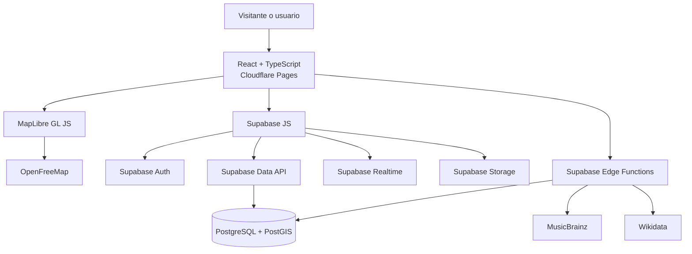

# Portal Rock Web 4.0 — Especificación formal

**Estado:** Borrador para revisión  
**Fecha:** 29 de septiembre de 2026  
**Idioma de producto:** Español  
**Versión objetivo:** 4.0  
**Costo operativo inicial:** USD 0 al mes dentro de los límites gratuitos  

## 1. Resumen ejecutivo

Portal Rock Web 4.0 será una aplicación pública y adaptable a celulares que permitirá explorar el origen geográfico de bandas icónicas, consultar información musical estructurada y participar en una comunidad. La aplicación reemplazará los archivos de texto de la versión 3.0 por PostgreSQL con PostGIS, incorporará datos de MusicBrainz y Wikidata y ofrecerá actividad comunitaria en tiempo real.

La primera versión pública se alojará con Cloudflare Pages y Supabase. El mapa se renderizará con MapLibre GL JS y utilizará un estilo vectorial de OpenFreeMap. Esta arquitectura evita servidores locales, permite acceso desde Internet y no requiere un pago mensual mientras el proyecto permanezca dentro de las cuotas gratuitas.

La identidad visual será contemporánea, editorial y musical. No reutilizará la apariencia de Windows 98 de la versión 3.0. Se conservarán el nombre, el tema de rock y el contenido histórico que pueda publicarse legalmente.

## 2. Objetivos

### 2.1 Objetivos del producto

1. Publicar el portal en Internet mediante una dirección HTTPS gratuita.
2. Mostrar en un mapa interactivo las ciudades en las que se formaron bandas icónicas.
3. Permitir explorar bandas por década, género, país y ciudad.
4. Mantener información musical normalizada en una base PostgreSQL real.
5. Complementar los datos con MusicBrainz y Wikidata sin depender de ellos en cada visita.
6. Permitir registro, inicio de sesión, perfil, favoritos y participación comunitaria.
7. Actualizar publicaciones, comentarios y presencia sin recargar la página.
8. Proteger cuentas y datos mediante Supabase Auth y políticas Row Level Security.
9. Funcionar correctamente en teléfonos, tabletas y computadoras.
10. Mantener el costo operativo en cero durante la etapa académica o de comunidad pequeña.

### 2.2 Indicadores de éxito

- Un visitante puede abrir el portal desde una URL pública y explorar el mapa sin registrarse.
- El mapa inicial presenta al menos 12 bandas con coordenadas verificadas.
- La selección de una banda abre su ficha sin recargar la página.
- Un usuario puede crear una cuenta, iniciar sesión, guardar favoritos y publicar.
- Dos navegadores abiertos reciben una publicación nueva en menos de cinco segundos.
- La aplicación conserva los datos después de un nuevo despliegue del frontend.
- Ninguna clave privada o credencial administrativa aparece en el código enviado al navegador.
- La interfaz supera una revisión manual en anchos de 360, 768 y 1440 píxeles.

## 3. Alcance de la primera versión pública

### 3.1 Incluido

- Página de inicio editorial.
- Mapa mundial interactivo.
- Doce bandas iniciales seleccionadas por el administrador.
- Filtros por década, género, país y texto.
- Perfil completo de cada banda.
- Registro, inicio de sesión, cierre de sesión y recuperación de contraseña.
- Perfil básico del usuario.
- Bandas favoritas.
- Foro con publicaciones, comentarios y reacciones.
- Actualización en tiempo real de publicaciones y comentarios.
- Panel administrativo básico para bandas y ubicaciones.
- Importación controlada desde MusicBrainz y Wikidata.
- Caché en PostgreSQL para datos externos.
- Despliegue automático desde GitHub.
- Documentación de instalación, administración y publicación.

### 3.2 Pospuesto para una segunda versión

- Mapa de tiendas de discos.
- Búsqueda de tiendas por distancia desde la ubicación del usuario.
- Seguimiento entre usuarios.
- Mensajes privados.
- Notificaciones push.
- Recomendaciones automáticas basadas en actividad.
- Aplicación móvil nativa.
- Compra o reproducción completa de música.
- Inicio de sesión con Google, GitHub u otros proveedores sociales.

### 3.3 Fuera de alcance

- Alojar canciones comerciales sin una licencia de distribución.
- Vender entradas, música o mercancía.
- Crear una red blockchain, criptomoneda, NFT o billetera.
- Permitir que el navegador consulte directamente credenciales privadas de servicios externos.
- Ofrecer disponibilidad garantizada mientras se utilicen planes gratuitos.

## 4. Usuarios y permisos

### 4.1 Visitante

- Puede abrir el inicio, mapa y perfiles de bandas.
- Puede usar filtros y búsquedas.
- Puede leer publicaciones, comentarios y conteos de reacciones.
- No puede publicar, comentar, reaccionar ni guardar favoritos.

### 4.2 Usuario autenticado

- Incluye todos los permisos del visitante.
- Puede editar su alias, biografía corta y avatar.
- Puede añadir o eliminar favoritos propios.
- Puede crear publicaciones y comentarios.
- Puede añadir o retirar una reacción propia.
- Puede editar o eliminar su propio contenido.
- Puede reportar contenido para revisión.

### 4.3 Moderador

- Incluye todos los permisos del usuario.
- Puede ocultar y restaurar publicaciones o comentarios reportados.
- Puede consultar la cola de reportes.
- No puede modificar bandas, ubicaciones ni roles.

### 4.4 Administrador

- Incluye todos los permisos del moderador.
- Puede crear, editar, publicar y archivar bandas.
- Puede administrar ubicaciones, géneros, álbumes e imágenes.
- Puede ejecutar la sincronización de MusicBrainz y Wikidata.
- Puede asignar los roles `usuario` y `moderador`.
- El rol `administrador` se asignará únicamente mediante una operación SQL protegida.

## 5. Arquitectura

### 5.1 Frontend

- React con TypeScript y Vite.
- Aplicación de una sola página con rutas públicas y protegidas.
- Componentes separados por dominio: mapa, bandas, comunidad, cuenta y administración.
- El cliente de Supabase gestionará autenticación, consultas autorizadas y suscripciones en tiempo real.
- MapLibre GL JS será responsable del mapa, cámara, marcadores, capas y agrupación de puntos.
- La aplicación se compilará como archivos estáticos y se desplegará en Cloudflare Pages.

### 5.2 Backend administrado

- PostgreSQL de Supabase será la fuente de verdad.
- PostGIS almacenará e indexará las ubicaciones geográficas.
- Supabase Auth administrará credenciales, correos y sesiones.
- Supabase Realtime notificará cambios de publicaciones y comentarios.
- Supabase Storage guardará avatares e imágenes autorizadas.
- Edge Functions ejecutarán integraciones externas y operaciones administrativas que requieran secretos.
- Row Level Security será obligatoria en toda tabla expuesta por la Data API.

### 5.3 Despliegue

- El código residirá en un repositorio GitHub.
- Cada cambio integrado en la rama principal iniciará una compilación de Cloudflare Pages.
- Las migraciones SQL se guardarán en el repositorio y se aplicarán con Supabase CLI.
- Producción utilizará variables de entorno diferentes a desarrollo.
- La URL inicial terminará en `pages.dev`; el dominio personalizado será opcional.

## 6. Modelo de datos

Todos los identificadores internos serán UUID. Todas las fechas se almacenarán como `timestamptz` en UTC.

### 6.1 Identidad

#### `profiles`

| Campo | Tipo | Regla |
|---|---|---|
| `id` | `uuid` | PK y referencia a `auth.users.id` |
| `username` | `citext` | Único, 3–24 caracteres |
| `display_name` | `text` | 1–50 caracteres |
| `bio` | `text` | Máximo 280 caracteres |
| `avatar_path` | `text` | Ruta de Storage o nulo |
| `role` | enum | `user`, `moderator`, `admin` |
| `created_at` | `timestamptz` | Automático |
| `updated_at` | `timestamptz` | Automático |

El nombre de usuario deberá coincidir con `^[A-Za-z0-9_-]{3,24}$`. La comparación será insensible a mayúsculas mediante `citext`.

### 6.2 Catálogo musical

#### `bands`

| Campo | Tipo | Regla |
|---|---|---|
| `id` | `uuid` | PK |
| `slug` | `text` | Único, apto para URL |
| `name` | `text` | Requerido |
| `summary` | `text` | 80–500 caracteres |
| `biography` | `text` | Texto editorial |
| `formation_year` | `smallint` | 1900–año actual |
| `disbanded_year` | `smallint` | Nulo o posterior a formación |
| `country_code` | `char(2)` | ISO 3166-1 alpha-2 |
| `musicbrainz_id` | `uuid` | Único o nulo |
| `wikidata_id` | `text` | Patrón `Q` + dígitos, único o nulo |
| `hero_image_path` | `text` | Imagen autorizada o nulo |
| `status` | enum | `draft`, `published`, `archived` |
| `created_at` | `timestamptz` | Automático |
| `updated_at` | `timestamptz` | Automático |

#### `band_locations`

| Campo | Tipo | Regla |
|---|---|---|
| `id` | `uuid` | PK |
| `band_id` | `uuid` | FK a `bands`, borrado en cascada |
| `label` | `text` | Ciudad o lugar mostrado |
| `location` | `extensions.geography(Point,4326)` | Requerido |
| `location_type` | enum | `formed`, `origin`, `scene` |
| `is_primary` | `boolean` | Solo uno primario por banda |
| `source_url` | `text` | Fuente de la coordenada |

El mapa mostrará por defecto las ubicaciones `is_primary = true` de bandas publicadas.

#### `genres`

- `id uuid` PK.
- `slug text` único.
- `name text` único.
- `color text` en formato hexadecimal de seis dígitos.

#### `band_genres`

- Clave primaria compuesta por `band_id` y `genre_id`.
- Ambas columnas serán claves foráneas con borrado en cascada.

#### `albums`

- `id uuid` PK.
- `band_id uuid` FK.
- `title text`.
- `release_year smallint`.
- `musicbrainz_id uuid` único o nulo.
- `cover_image_url text` o nulo.
- `is_featured boolean`.

### 6.3 Comunidad

#### `posts`

- `id uuid` PK.
- `author_id uuid` FK a `profiles`.
- `band_id uuid` FK opcional a `bands`.
- `body text` entre 1 y 1,200 caracteres.
- `status` enum `visible`, `hidden`, `deleted`.
- `created_at` y `updated_at`.

#### `comments`

- `id uuid` PK.
- `post_id uuid` FK con borrado en cascada.
- `author_id uuid` FK.
- `body text` entre 1 y 800 caracteres.
- `status` enum `visible`, `hidden`, `deleted`.
- `created_at` y `updated_at`.

#### `reactions`

- `user_id uuid` FK.
- `post_id uuid` FK.
- `reaction_type` enum `like`, `love`, `rock`.
- Clave primaria compuesta por `user_id` y `post_id`.
- Un usuario podrá conservar como máximo una reacción por publicación; cambiarla reemplazará la anterior.

#### `favorites`

- `user_id uuid` FK.
- `band_id uuid` FK.
- `created_at timestamptz`.
- Clave primaria compuesta por `user_id` y `band_id`.

#### `reports`

- `id uuid` PK.
- `reporter_id uuid` FK.
- `post_id uuid` o `comment_id uuid`, exactamente uno requerido.
- `reason` enum `spam`, `abuse`, `copyright`, `other`.
- `details text` máximo 500 caracteres.
- `status` enum `open`, `resolved`, `dismissed`.
- `resolved_by uuid` opcional.
- `created_at` y `resolved_at`.

### 6.4 Integraciones

#### `api_cache`

- `cache_key text` PK.
- `provider` enum `musicbrainz`, `wikidata`.
- `payload jsonb`.
- `fetched_at timestamptz`.
- `expires_at timestamptz`.
- `last_status smallint`.

#### `sync_runs`

- `id uuid` PK.
- `provider` enum.
- `band_id uuid` opcional.
- `requested_by uuid`.
- `status` enum `running`, `success`, `partial`, `failed`.
- `summary jsonb` sin secretos.
- `started_at` y `finished_at`.

### 6.5 Tiendas, reservadas para la segunda versión

La primera versión no creará la tabla `record_stores`. La segunda versión añadirá una migración independiente con nombre, dirección, ciudad, país, punto PostGIS, sitio web, estado de verificación, fuente y fecha de revisión.

## 7. APIs y contratos internos

### 7.1 Lecturas públicas mediante Supabase Data API

Las siguientes vistas serán públicas y de solo lectura:

- `published_bands`: datos resumidos de bandas publicadas.
- `band_map_points`: banda, género principal y coordenada primaria.
- `public_posts`: publicaciones visibles con datos públicos del autor.
- `public_comments`: comentarios visibles con datos públicos del autor.

Las biografías completas y álbumes se consultarán por `slug`. Las consultas del mapa admitirán cuadro visible, década, país, género y texto. El filtro geográfico se implementará mediante una función SQL que reciba límites de latitud y longitud.

### 7.2 Edge Function `sync-band`

- Método: `POST`.
- Acceso: administrador.
- Entrada: `{ "bandId": "uuid", "providers": ["musicbrainz", "wikidata"] }`.
- Salida: resumen de campos añadidos, modificados, ignorados y errores.
- MusicBrainz se consultará con un `User-Agent` identificable y nunca a más de una solicitud por segundo por instancia lógica.
- Los datos externos no sobrescribirán automáticamente `biography`, `summary`, coordenadas verificadas ni imágenes cargadas por el administrador.
- Las respuestas exitosas se guardarán por siete días; los errores temporales se guardarán por cinco minutos.

### 7.3 Edge Function `admin-import`

- Método: `POST`.
- Acceso: administrador.
- Entrada: lote máximo de 25 identificadores de MusicBrainz o Wikidata.
- Comportamiento: crea borradores, nunca publica automáticamente.
- Salida: resultado individual por identificador.

### 7.4 Datos en tiempo real

- El cliente se suscribirá a inserciones y actualizaciones de `posts` y `comments` visibles.
- Las eliminaciones lógicas aparecerán como contenido retirado sin revelar el texto anterior.
- La interfaz mantendrá paginación; Realtime añadirá elementos nuevos, pero no reemplazará la carga histórica.
- No se transmitirá presencia exacta ni última conexión pública de cada usuario en la primera versión.

## 8. Reglas de seguridad

### 8.1 Autenticación

- Supabase Auth gestionará correo, contraseña, recuperación y sesión.
- El correo no se almacenará en `profiles` ni se expondrá mediante vistas públicas.
- Se requerirá verificación de correo antes de publicar.
- La contraseña mínima será de 10 caracteres.
- La interfaz no registrará contraseñas, tokens ni respuestas completas de autenticación.

### 8.2 Row Level Security

- Toda tabla del esquema público tendrá RLS activada.
- Visitantes solo leerán vistas o filas explícitamente públicas.
- Un usuario solo podrá modificar su propio perfil, favoritos, publicaciones, comentarios y reacciones.
- Ningún usuario podrá cambiar su campo `role`.
- Moderadores solo podrán ejecutar funciones de moderación con `security definer` y comprobación interna de rol.
- Las claves de servicio se utilizarán únicamente en Edge Functions y tareas administrativas.
- Los buckets de avatar e imágenes tendrán políticas separadas y límites de tipo y tamaño.

### 8.3 Protección de contenido

- Publicaciones y comentarios se renderizarán como texto, no como HTML.
- El frontend y la base de datos impondrán los mismos límites de longitud.
- Avatares aceptarán JPEG, PNG o WebP de hasta 2 MB.
- Imágenes de bandas aceptarán JPEG, PNG o WebP de hasta 5 MB y solo podrán cargarlas administradores.
- Se limitarán las acciones repetidas mediante funciones SQL y límites por usuario.
- El panel no mostrará secretos, tokens ni datos privados de autenticación.

### 8.4 Derechos de autor

- Los MP3 comerciales de la versión 3.0 no se desplegarán públicamente.
- Solo se alojará audio propio, de dominio público o con licencia compatible.
- Las canciones comerciales se representarán mediante enlaces o reproductores oficiales cuando las condiciones del proveedor lo permitan.
- Cada imagen importada tendrá fuente, autor y licencia cuando esos datos estén disponibles.

## 9. Integración con fuentes externas

### 9.1 MusicBrainz

Se utilizará para identificadores, nombres oficiales, áreas, fechas, integrantes y lanzamientos. Las consultas saldrán exclusivamente desde Edge Functions, respetarán el límite de una solicitud por segundo y enviarán un `User-Agent` con nombre del proyecto y contacto administrativo.

Fuente: <https://musicbrainz.org/doc/MusicBrainz_API>

### 9.2 Wikidata

Se utilizará para identificadores relacionados, coordenadas, país, ciudad de origen y referencias a Wikimedia Commons. Las consultas SPARQL serán pequeñas, parametrizadas y almacenadas en caché. Ningún resultado publicará automáticamente una banda.

Fuente: <https://www.mediawiki.org/wiki/Wikidata_query_service/User_Manual>

### 9.3 MapLibre y OpenFreeMap

MapLibre será el motor de renderizado. OpenFreeMap proporcionará el estilo y los mosaicos vectoriales iniciales. La atribución requerida permanecerá visible. El proveedor de mosaicos quedará aislado en una configuración para poder sustituirlo sin reescribir los componentes del mapa.

Fuentes:

- <https://maplibre.org/maplibre-gl-js/docs/>
- <https://openfreemap.org/quick_start/>

## 10. Experiencia y diseño visual

### 10.1 Dirección artística

La interfaz utilizará una estética editorial musical de la década de 2020:

- Fondo carbón con matices azul petróleo.
- Superficies sólidas y translúcidas con contraste legible.
- Un color eléctrico por género musical.
- Tipografía de exhibición para títulos y sans serif para lectura.
- Fotografías grandes con tratamiento consistente.
- Animaciones de 150–400 ms, sin bloquear la interacción.
- Texturas sutiles inspiradas en vinilo, papel de concierto y luces de escenario.
- Ausencia de marcos, botones y tipografía de Windows 98.

### 10.2 Navegación principal

- Inicio.
- Explorar mapa.
- Bandas.
- Comunidad.
- Favoritos, visible al iniciar sesión.
- Perfil.
- Administración, visible solo para roles autorizados.

En celulares, las cuatro secciones principales usarán navegación inferior. Las acciones secundarias se ubicarán en un menú de perfil.

### 10.3 Inicio

- Encabezado con propuesta de valor y acceso al mapa.
- Banda editorial destacada.
- Mapa reducido con puntos activos.
- Selección de bandas por década.
- Actividad reciente de la comunidad.
- Llamada a crear una cuenta.

### 10.4 Mapa

- Mapa a pantalla amplia en escritorio y pantalla completa en móvil.
- Panel lateral en escritorio y hoja inferior en móvil.
- Marcadores agrupados al alejarse.
- Marcador personalizado por género principal.
- Tarjeta previa al seleccionar un punto.
- Transición `flyTo` al cambiar de banda o ciudad.
- Filtros combinables con botón visible para restablecer.
- URL con estado de filtros para compartir una vista.
- Lista accesible equivalente para usuarios que no puedan operar el mapa.

### 10.5 Perfil de banda

- Imagen principal, nombre, lugar y fechas.
- Géneros y etiquetas.
- Historia editorial.
- Mapa contextual.
- Álbumes destacados.
- Enlaces externos verificados.
- Botón de favorito.
- Conversaciones relacionadas.

### 10.6 Comunidad

- Lista paginada con carga de elementos nuevos en tiempo real.
- Editor de texto simple sin HTML ni archivos adjuntos en la primera versión.
- Filtro general o por banda.
- Comentarios, reacción única y reporte.
- Estado vacío, carga, error y reconexión claramente visibles.

## 11. Accesibilidad

- Objetivo mínimo WCAG 2.2 nivel AA en los recorridos principales.
- Todas las funciones tendrán acceso por teclado.
- Los controles mostrarán foco visible.
- El color no será el único medio de comunicar estado.
- Las imágenes informativas tendrán texto alternativo.
- Los botones de icono tendrán nombre accesible.
- La lista equivalente del mapa permitirá explorar lugares sin gestos de mapa.
- `prefers-reduced-motion` reducirá desplazamientos, zoom y transiciones.
- El contraste de texto normal será como mínimo 4.5:1.

## 12. Rendimiento

- La ruta inicial no cargará datos completos de todas las bandas.
- El mapa se cargará al entrar en Inicio o Explorar y no bloqueará el contenido textual.
- Las imágenes se servirán en WebP cuando sea posible y con tamaños responsivos.
- Las páginas de administración se cargarán de forma diferida.
- Las consultas usarán índices B-tree, GIN o GiST según corresponda.
- La paginación del foro será por cursor con 20 elementos por solicitud.
- Las búsquedas de texto tendrán retardo de 250 ms y se cancelarán al escribir una consulta nueva.
- Los resultados externos se leerán desde caché durante su periodo de vigencia.

## 13. Manejo de errores

- Si OpenFreeMap falla, el mapa mostrará un estado de indisponibilidad y la lista de bandas continuará funcionando.
- Si MusicBrainz o Wikidata falla, se conservará la última información válida y se registrará el error de sincronización.
- Si Realtime se desconecta, la aplicación indicará reconexión y seguirá permitiendo lectura mediante consultas normales.
- Si Supabase no responde, las acciones de escritura conservarán el texto en el formulario hasta que el usuario decida reintentar.
- Los errores técnicos se registrarán sin incluir contraseñas, tokens, correos completos ni contenido eliminado.
- Las funciones externas usarán tiempos de espera y no reintentarán indefinidamente.

## 14. Migración desde Portal Rock Web 3.0

### 14.1 Contenido

- Se conservarán los textos históricos de Queen, Guns N’ Roses, Metallica y Bon Jovi como borradores editoriales.
- Cada texto será revisado antes de publicarse y recibirá fuentes cuando corresponda.
- Los MP3 actuales permanecerán fuera del despliegue público.
- El diseño y el servidor Python de la versión 3.0 se archivarán como referencia y no formarán parte del paquete de producción.

### 14.2 Usuarios y contraseñas

- Los hashes PBKDF2 del archivo `usuarios.txt` no se trasladarán a Supabase Auth.
- No se intentará convertir ni recuperar contraseñas.
- Si existen usuarios reales, se importarán únicamente sus nombres reservados y se les pedirá crear una cuenta nueva mediante correo.
- Si el archivo está vacío, no se realizará ninguna migración de cuentas.

### 14.3 Mensajes

- Los mensajes existentes se importarán solo si tienen autor reconocible, fecha válida y contenido dentro del nuevo límite.
- Se marcarán como `legacy_import` en metadatos internos de auditoría.
- Los mensajes inválidos se incluirán en un informe y no se insertarán parcialmente.

## 15. Plan gratuito y límites operativos

La arquitectura se mantendrá en los límites publicados del plan gratuito de Supabase: 500 MB de base de datos, 50,000 usuarios activos mensuales, 1 GB de archivos, 5 GB de transferencia, 500,000 invocaciones de Edge Functions, dos millones de mensajes Realtime y 200 conexiones simultáneas.

Cloudflare Pages alojará la compilación estática y permitirá hasta 500 compilaciones mensuales en su plan gratuito. La aplicación utilizará inicialmente la URL gratuita `pages.dev`.

Las cuotas se supervisarán mensualmente. Al alcanzar el 70 % de cualquier límite, el administrador recibirá una indicación en la documentación operativa para reducir uso, archivar datos o evaluar un plan de pago. La aplicación no activará automáticamente ningún servicio facturable.

El proyecto gratuito de Supabase puede pausarse tras una semana sin actividad. Esta limitación se acepta para la etapa inicial; la interfaz mostrará un mensaje comprensible si el backend no está disponible y el administrador podrá reactivarlo desde Supabase.

Fuentes:

- <https://supabase.com/docs/guides/platform/billing-on-supabase>
- <https://supabase.com/docs/guides/realtime/limits>
- <https://supabase.com/docs/guides/functions/pricing>
- <https://developers.cloudflare.com/pages/platform/limits/>

## 16. Entornos y configuración

### 16.1 Local

- Node.js LTS.
- Supabase CLI y Docker para servicios locales.
- Variables públicas en `.env.local` sin incluir claves administrativas.
- Datos iniciales reproducibles mediante migraciones y una semilla.

### 16.2 Producción

- Cloudflare Pages para el frontend.
- Un proyecto Supabase gratuito para base, autenticación, almacenamiento, Realtime y funciones.
- Variables de Cloudflare para URL y clave pública de Supabase.
- Secretos de proveedores almacenados exclusivamente como secretos de Edge Functions.
- HTTPS obligatorio.

## 17. Estrategia de pruebas

### 17.1 Base de datos

- Migraciones desde una base vacía.
- Restricciones de longitudes, años y unicidad.
- Consultas PostGIS dentro de un cuadro visible.
- Políticas RLS para visitante, propietario, moderador y administrador.
- Eliminaciones en cascada y eliminaciones lógicas.

### 17.2 Edge Functions

- Autorización administrativa.
- Respuestas válidas, incompletas, lentas y fallidas de MusicBrainz y Wikidata.
- Caché vigente y vencida.
- Respeto del límite de MusicBrainz.
- Prevención de sobrescritura de contenido editorial.

### 17.3 Frontend

- Filtros individuales y combinados.
- Estado del mapa reflejado en la URL.
- Registro, acceso, recuperación y cierre de sesión.
- Favoritos.
- Publicación, comentario, reacción y reporte.
- Estados vacíos, de carga, error y reconexión.
- Navegación por teclado y reducción de movimiento.

### 17.4 Recorridos de aceptación

1. Visitante abre la URL pública, filtra bandas de Reino Unido y abre Queen.
2. Usuario crea una cuenta, verifica el correo, inicia sesión y guarda Queen.
3. Usuario publica en la conversación de Queen y recibe su publicación en una segunda pestaña.
4. Moderador oculta una publicación reportada; deja de aparecer para visitantes.
5. Administrador importa una banda mediante MusicBrainz, revisa el borrador, añade coordenada y la publica.
6. Usuario opera el flujo principal en un ancho de 360 píxeles sin desplazamiento horizontal de página.

## 18. Criterios de aceptación de la versión 4.0

La versión estará lista para publicación cuando:

- Exista una URL HTTPS pública en Cloudflare Pages.
- Las migraciones creen una base Supabase nueva sin intervención manual adicional.
- PostGIS esté instalado en un esquema no expuesto directamente.
- Haya 12 bandas publicadas con coordenadas y fuentes.
- Los filtros del mapa produzcan resultados correctos y compartibles.
- Registro, verificación, acceso, recuperación y cierre funcionen.
- Las políticas RLS impidan modificar datos de otro usuario.
- Foro, comentarios, reacciones y favoritos persistan en PostgreSQL.
- Los cambios comunitarios aparezcan en tiempo real en una segunda sesión.
- La sincronización respete caché, límites y permisos.
- No se desplieguen MP3 comerciales ni secretos.
- Las pruebas automatizadas de base, funciones y recorridos críticos pasen.
- La revisión manual responsive y accesible no encuentre bloqueos críticos.
- La guía de administración explique despliegue, reactivación, copias y cuotas.

## 19. Secuencia de entrega

1. **Fundación:** repositorio, React, Supabase local, migraciones, autenticación y despliegue vacío.
2. **Catálogo:** tablas musicales, semilla, administración y perfiles de banda.
3. **Mapa:** PostGIS, MapLibre, capas, marcadores, filtros y rutas compartibles.
4. **Integraciones:** MusicBrainz, Wikidata, caché, sincronización e informes.
5. **Comunidad:** perfiles, publicaciones, comentarios, reacciones, favoritos y Realtime.
6. **Terminación:** migración selectiva, accesibilidad, rendimiento, seguridad, pruebas y documentación.

Cada entrega deberá ser desplegable y verificable antes de comenzar la siguiente.

## 20. Riesgos y mitigaciones

| Riesgo | Consecuencia | Mitigación |
|---|---|---|
| Pausa de Supabase por inactividad | Primera visita sin datos | Mensaje claro, guía de reactivación y evaluación de pago si se requiere disponibilidad continua |
| Cambio de cuota gratuita | Costo o restricción futura | Aislar proveedores, supervisar cuotas y documentar migración |
| Datos externos incompletos | Fichas incorrectas | Importar como borrador y exigir revisión administrativa |
| Límite de MusicBrainz | Sincronización lenta o bloqueo | Una petición por segundo, caché y lotes pequeños |
| Caída del proveedor cartográfico | Mapa temporalmente vacío | Lista alternativa y configuración intercambiable de mosaicos |
| Contenido con derechos de autor | Retirada o reclamación | No alojar MP3 comerciales y registrar licencias de imágenes |
| Políticas RLS incorrectas | Acceso indebido | Pruebas automatizadas por rol y revisión antes de producción |
| Crecimiento del foro | Exceso de almacenamiento | Paginación, límites, moderación y política de conservación |

## 21. Decisiones cerradas

- La aplicación se preparará para Internet y no dependerá de la computadora del administrador.
- El costo mensual inicial será cero.
- La base de datos será PostgreSQL con PostGIS en Supabase.
- La autenticación y el tiempo real serán de Supabase.
- El frontend será React con TypeScript y Vite en Cloudflare Pages.
- El mapa utilizará MapLibre y OpenFreeMap.
- MusicBrainz y Wikidata se consultarán desde Edge Functions con caché.
- El mapa de origen de bandas será la función geográfica principal.
- Las tiendas de discos se implementarán después de la primera versión pública.
- No se publicarán copias de canciones comerciales.
