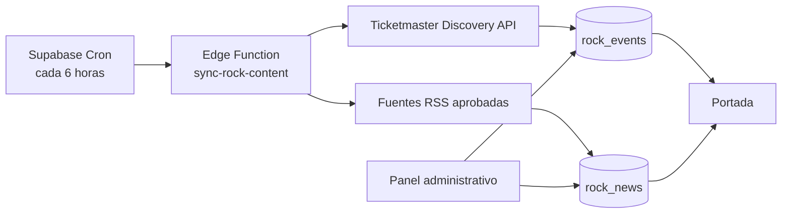

# Portal Rock: portada de noticias y conciertos

**Fecha:** 2026-10-21  
**Estado:** Diseño aprobado  
**Base:** Portal Rock Web 4.0 con React, TypeScript y Supabase

## Objetivo

Transformar la portada simple de Portal Rock en un periódico musical moderno que priorice noticias y conciertos de México y muestre una selección secundaria de contenido internacional. El sistema se actualizará cada seis horas, conservará los últimos datos válidos ante fallos externos y permitirá que un administrador controle qué noticias se publican.

La cobertura incluirá rock, metal, punk y música alternativa, sin limitarse a las bandas existentes en el catálogo.

## Decisiones aprobadas

- Diseño visual B: **Periódico musical**.
- México es el mercado principal; el contenido internacional es secundario.
- Actualización automática cada seis horas.
- Sistema mixto: conciertos automáticos y noticias sujetas a moderación.
- Ticketmaster Discovery API será la fuente inicial de eventos.
- Fuentes RSS revisadas serán la fuente inicial de noticias.
- Supabase almacenará los datos, ejecutará la sincronización y protegerá las claves.

## Arquitectura

Una función de Supabase denominada `sync-rock-content` consultará Ticketmaster y una lista administrable de fuentes RSS. Supabase Cron la invocará cada seis horas. La función normalizará, validará y guardará los resultados mediante operaciones idempotentes.

La aplicación React leerá exclusivamente las tablas públicas de Supabase. El navegador no consultará Ticketmaster ni fuentes RSS y nunca recibirá claves privadas.

Supabase Cron permite invocar Edge Functions mediante `pg_cron` y `pg_net`; las credenciales de producción se guardarán como secretos de Edge Functions. Referencias: [programación de Edge Functions](https://supabase.com/docs/guides/functions/schedule-functions), [secretos de funciones](https://supabase.com/docs/guides/functions/secrets).

## Fuentes externas

### Ticketmaster

La sincronización realizará una consulta principal con `countryCode=MX`, fechas futuras y clasificaciones compatibles con rock, metal, punk y alternativo. Una consulta separada obtendrá una selección internacional limitada. Se almacenará el enlace oficial proporcionado por Ticketmaster y no se copiará contenido de venta de entradas.

Ticketmaster admite México, filtros por país, clasificación y fecha, y entrega datos de eventos, recintos, imágenes y estados. Referencia: [Discovery API v2](https://developer.ticketmaster.com/products-and-docs/apis/discovery/v2/).

### Noticias RSS

Las fuentes se registrarán en `rock_news_sources`. Solamente se añadirán medios identificables con RSS estable, atribución clara y permiso para enlazar sus publicaciones. El sistema conservará título, extracto, imagen si está disponible, fuente, fecha y enlace original. Portal Rock no reproducirá el artículo completo.

Cada noticia importada comenzará en estado `pending`. La incorporación de una fuente nueva requerirá una acción administrativa y no ocurrirá automáticamente por descubrimiento web.

## Modelo de datos

### `rock_events`

- `id`: UUID interno.
- `provider`: inicialmente `ticketmaster`.
- `external_id`: identificador del proveedor; único junto con `provider`.
- `name`, `artist_name`, `description`.
- `starts_at`, `timezone`.
- `venue_name`, `city`, `state`, `country_code`.
- `latitude`, `longitude` cuando existan.
- `image_url`, `ticket_url` con HTTPS obligatorio.
- `genres`: arreglo normalizado.
- `scope`: `mexico` o `international`.
- `status`: `scheduled`, `postponed`, `cancelled` o `completed`.
- `hidden`: ocultación editorial sin borrar el registro.
- `source_updated_at`, `last_seen_at`, `created_at`, `updated_at`.

Los eventos se actualizarán por `(provider, external_id)`. Un evento no visto en varias sincronizaciones no se eliminará; quedará fuera de la portada cuando haya pasado su fecha o sea ocultado.

### `rock_news`

- `id`: UUID interno.
- `source_id`: referencia a `rock_news_sources`.
- `canonical_url` y `url_hash` único para deduplicación.
- `title`, `summary`, `image_url`.
- `published_at`, `fetched_at`.
- `category`: `mexico`, `international`, `releases`, `festivals` u `other`.
- `status`: `pending`, `approved` o `rejected`.
- `featured`: indica la historia principal.
- `editorial_order`: prioridad manual.
- `reviewed_by`, `reviewed_at`, `created_at`, `updated_at`.

Solo podrá existir una historia principal aprobada. Marcar otra noticia como principal retirará ese estado de la anterior en una única operación de base de datos.

### `rock_news_sources`

- Nombre, URL del feed y URL del medio.
- País, idioma y categorías permitidas.
- Estado activo.
- Fecha del último éxito y mensaje del último error.

### `content_sync_runs`

Registrará tipo de ejecución, inicio, final, estado, cantidades insertadas y actualizadas, advertencias y un resumen seguro del error. Nunca almacenará claves ni respuestas completas que puedan incluir datos sensibles.

## Seguridad y políticas RLS

- Lectura pública de eventos futuros que no estén ocultos.
- Lectura pública de noticias aprobadas únicamente.
- Moderadores y administradores pueden aprobar, rechazar y editar contenido.
- Solo administradores pueden administrar fuentes y ejecutar una sincronización manual.
- Las escrituras del importador se realizarán dentro de la Edge Function con una credencial privada.
- `TICKETMASTER_API_KEY` se configurará como secreto de Supabase y no se incluirá en Git ni en variables `VITE_*`.
- Las URL externas se validarán como HTTPS antes de guardarse o mostrarse.

## Flujo de sincronización

1. Cron invoca `sync-rock-content` cada seis horas.
2. La función crea un registro `content_sync_runs` en estado `running`.
3. Consulta eventos de México y después una selección internacional.
4. Normaliza géneros y actualiza eventos por identificador externo.
5. Procesa cada RSS de manera independiente.
6. Normaliza enlaces, elimina parámetros de seguimiento y deduplica por huella.
7. Inserta noticias nuevas como `pending`; nunca vuelve a poner una noticia rechazada como pendiente.
8. Finaliza el registro con conteos y errores por fuente.

Un fallo de una fuente no cancelará las demás. Las solicitudes tendrán tiempo límite y reintentos breves para errores temporales. La ejecución debe terminar dentro de los límites de una Edge Function del plan gratuito.

## Portada: Periódico musical

### Historia principal

La noticia aprobada con `featured=true` ocupará el bloque dominante. Mostrará imagen, categoría, título, resumen, fuente, fecha y enlace al artículo original. Si no existe una historia principal, se usará la noticia aprobada de mayor prioridad y fecha.

### Actualidad rápida

Una columna tendrá pestañas México, Internacional y Estrenos. Cada pestaña mostrará noticias aprobadas ordenadas por prioridad editorial y fecha.

### Noticias destacadas

Una cuadrícula de tres tarjetas mostrará imagen, categoría, título, fuente y fecha. Las tarjetas sin imagen usarán un fallback gráfico de Portal Rock.

### Próximos conciertos

La sección principal mostrará eventos mexicanos, con accesos rápidos para CDMX, Monterrey, Guadalajara y otras ciudades disponibles. Cada tarjeta incluirá fecha, artista, recinto, ciudad y enlace oficial. Una sección menor mostrará eventos internacionales.

Cuando el nombre normalizado de un artista coincida con una banda publicada, se mostrará un enlace adicional a su perfil de Portal Rock.

### Conexión con el portal

El cierre de la portada conservará llamadas al mapa y a la comunidad para integrar la nueva experiencia con las funciones existentes.

## Diseño adaptable y accesibilidad

- Escritorio: historia principal y actualidad rápida en dos columnas; cuadrículas de tres tarjetas.
- Tableta: portada en dos columnas reducidas y eventos con desplazamiento horizontal accesible.
- Móvil: una columna en orden historia, actualidad, noticias, conciertos y enlaces del portal.
- Las imágenes tendrán texto alternativo o se marcarán como decorativas según su función.
- Las pestañas usarán semántica y navegación por teclado.
- El foco será visible y el contraste mantendrá el sistema oscuro, naranja y crema actual.
- No habrá desplazamiento horizontal de la página a 360 píxeles.

## Panel administrativo

El módulo actual de administración añadirá:

- Bandeja de noticias pendientes.
- Vista previa antes de aprobar.
- Edición de título, resumen y categoría.
- Aprobación, rechazo y selección de historia principal.
- Orden editorial de noticias aprobadas.
- Ocultación de eventos incorrectos.
- Administración de fuentes RSS.
- Botón de sincronización manual con prevención de ejecuciones simultáneas.
- Historial de sincronizaciones y errores resumidos.

## Estados y fallos

- La portada utiliza siempre el último contenido persistido; no depende de una API durante la visita.
- Si no hay noticias aprobadas, se mostrará una introducción editorial y la sección de eventos disponible.
- Si no hay eventos futuros, se mostrará un mensaje y acceso al mapa.
- Las imágenes rotas cambiarán al fallback sin ocultar el texto.
- Los eventos cancelados o aplazados mostrarán su estado y no presentarán un llamado engañoso a comprar.
- La fecha de última actualización estará disponible para diagnóstico administrativo.

## Pruebas y aceptación

### Automatizadas

- Normalización de eventos y noticias.
- Deduplicación y actualizaciones idempotentes.
- Filtros de país, género y fechas futuras.
- Conservación de estados editoriales durante una nueva importación.
- Transición de noticia principal en una sola operación.
- Fallos parciales, reintentos y registro de sincronización.
- Políticas RLS para visitantes, moderadores y administradores.
- Renderizado de portada, tabs, fallbacks y estados vacíos.
- Panel de moderación y permisos.

### Aceptación manual

- La portada responde correctamente a 360, 768 y 1440 píxeles.
- México aparece antes que el contenido internacional.
- Solamente se muestran noticias aprobadas.
- Las fuentes y enlaces externos son visibles y correctos.
- Los eventos vencidos no aparecen como próximos.
- Una caída simulada de Ticketmaster o de un RSS no vacía la portada.
- La sincronización programada y manual deja un registro consultable.

## Fuera de alcance

- Copiar artículos completos o eludir restricciones de medios.
- Venta propia de entradas.
- Personalización de noticias por usuario.
- Notificaciones push o correo de nuevos conciertos.
- Comentarios independientes dentro de cada noticia.
- Incorporación automática de fuentes RSS no revisadas.

## Despliegue

El cambio requerirá migraciones de base de datos, despliegue de la Edge Function, configuración del secreto `TICKETMASTER_API_KEY`, carga inicial de fuentes RSS y activación del trabajo Cron. La documentación operativa incluirá comandos de despliegue, verificación, ejecución manual y desactivación segura del Cron.
